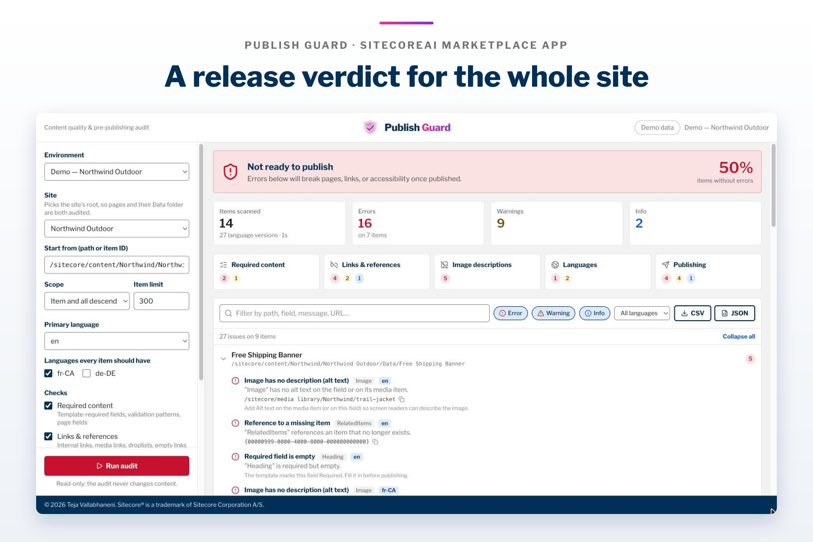
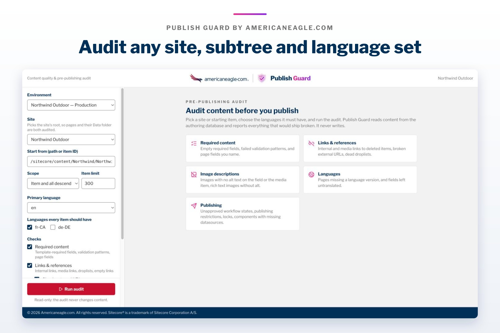
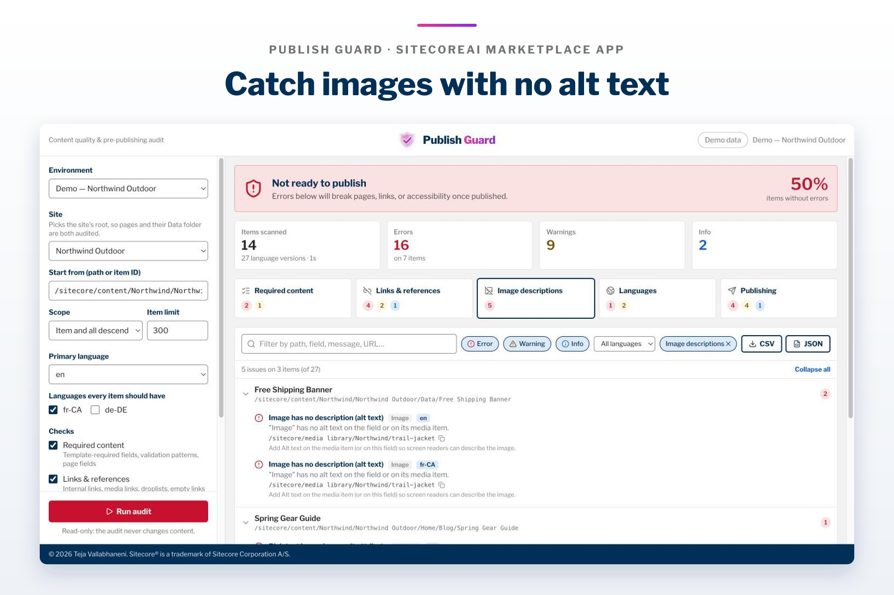
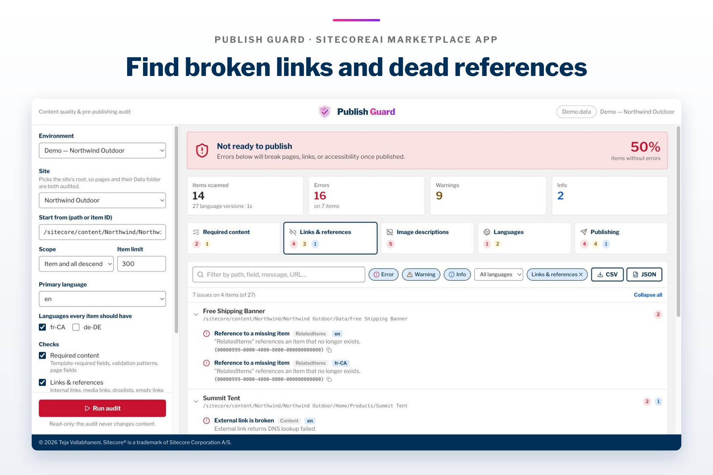
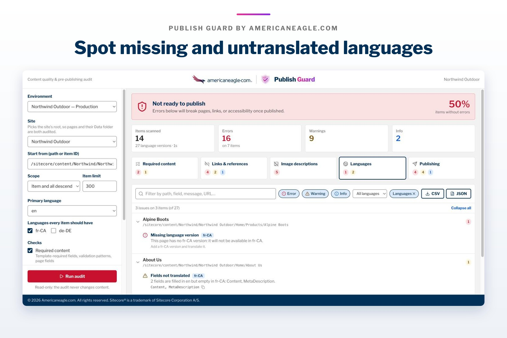
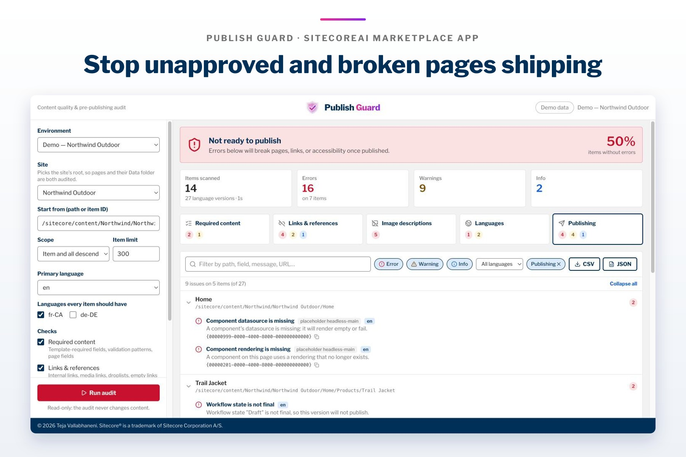

# Publish Guard (code name ReleaseGuard)

A SitecoreAI Marketplace app for checking content before you publish. Personal project by
[Teja Vallabhaneni](https://teja-vallabhaneni.vercel.app).



## Summary

Publish Guard audits a whole SitecoreAI site, or any subtree, in one pass and tells you whether it is ready to
publish. It flags empty required fields, broken links and references, images without alt text, missing or
untranslated language versions, unapproved workflow states and components with missing datasources, then gives a
release verdict (**Not ready / Ready with warnings / Ready**) with an exportable CSV or JSON report. It is
read-only: it never creates, changes or deletes content.

- **Live demo:** <https://sitecoreai-releaseguard.vercel.app> (opens an offline demo outside Sitecore)
- **How-to guide:** [How to Use Publish Guard: Audit SitecoreAI Content Before You Publish](https://tejavallabhanenisitecore.wordpress.com/2026/11/09/publish-guard-sitecoreai-pre-publishing-content-audit/)

## Overview

Bulk content quality and pre-publishing audit for SitecoreAI. Point it at a site
or any item, pick the languages the content must exist in, and it reports
everything that would ship broken — before anyone clicks Publish.

Publish Guard is a **custom Marketplace app** (Next.js 16) opened from Cloud
Portal or from inside SitecoreAI. It reads the authoring (`master`) database
through the Authoring GraphQL API via the Marketplace SDK. **It never writes.**

## What it checks

| Category | Checks | Severity |
|---|---|---|
| **Required content** | Fields whose template field has the *Required* validator (`{59D4EE10-…}`) on any validation bar, in every audited language · values failing the field's *Validation* regex · configurable page fields (default `Title`) on items with a layout | error / warning |
| **Links & references** | General Link internal/media targets that no longer exist · rich-text `~/link.aspx?_id=` and `-/media/` links to deleted items · Droplink/Multilist/Treelist references to deleted items · empty links (`href="#"`, no URL) · external URLs that 404/410/5xx or fail DNS · `http://` links | error / warning / info |
| **Image descriptions** | Image fields with no alt on the field *and* no `Alt` on the media item · rich-text `` with no `alt` attribute · images pointing at deleted media | error |
| **Languages** | Items with no version in a required language (error for pages, warning otherwise) · fields filled in the primary language but empty in a translation · no version in the primary language | error / warning |
| **Publishing** | Workflow state not final · *Never publish* · *Hide version* · future *Publish*/*Valid from* dates · past *Unpublish*/*Valid to* dates · locked items · components whose datasource or rendering definition is missing (`__Renderings` and `__Final Renderings`) | error / warning / info |

Results show a release verdict (**Not ready / Ready with warnings / Ready**), a
readiness score (share of items without errors), per-category counts, and a
filterable issue list grouped by item. Export as **CSV** or **JSON**.

## Set up Publish Guard

### Prerequisites

- **Node.js 20 or later** and npm
- A **SitecoreAI** organization, and access to **App studio** in Cloud Portal
- A place to host the app over HTTPS. These steps use **Vercel**; any Next.js host works.

### 1. Get the code and try the demo

```bash
git clone https://github.com/tejavallabhaneni/sitecoreai-releaseguard.git
cd sitecoreai-releaseguard
npm install
npm run dev      # http://localhost:43160
```

Open <http://localhost:43160> in a normal browser tab. Outside Sitecore the app runs an **offline demo**: a seeded
"Northwind Outdoor" site with most issue types and a **Demo data** chip in the header. Nothing connects to Sitecore.

Optional checks before you deploy:

```bash
npm test         # vitest: parsers, rules, engine against the demo source
npm run lint
npm run build
```

Configuration is optional. Copy [`.env.example`](.env.example) to `.env.local` to change defaults such as the item
limit, batch size, timeouts or the starting path. `NEXT_PUBLIC_*` values are built into the app, so rebuild after
changing them.

### 2. Deploy it

**Vercel dashboard:** **Add New → Project**, import your copy of this repository, keep the **Next.js** preset and deploy.
Every push to `main` then redeploys the same URL.

**Or the Vercel CLI:**

```bash
npx vercel link
npx vercel --prod
```

Note the production URL, for example `https://your-app.vercel.app`. The public demo runs at
<https://sitecoreai-releaseguard.vercel.app>.

### 3. Register the app in App studio

1. In **Cloud Portal**, open **App studio → Studio → Create app** and create a **custom app** named `Publish Guard`.
2. **Deployment URL:** the origin the app is served from, origin only (e.g. `https://your-app.vercel.app`, or
   `http://localhost:43160` while developing).
3. **Extension point:** **SitecoreAI full screen** with route `/sitecore` (or **Standalone** with route `/`).
4. **API access:** enable **SitecoreAI APIs**. This grants `xmc.authoring.graphql`, which the audit needs to read content.
5. **App logo:** upload [`public/branding/publish-guard-logo-512.png`](public/branding/publish-guard-logo-512.png).
6. **Activate** the app.

Custom apps are **organization-private**: only users in your organization can see and install them.

### 4. Install it on your environments

In Cloud Portal open **My apps**, select Publish Guard, choose **Update installation options**, and install it on
every SitecoreAI environment you want to audit. The **Environment** list in the app shows the environments the app
has been given access to.

### 5. Open it

Open Publish Guard from **Cloud Portal → My apps**, or from inside **SitecoreAI** through the extension point you chose.
Inside Sitecore it uses your real session, so it can read every environment it's installed on.

## Use Publish Guard



1. **Environment:** pick the SitecoreAI environment to audit.
2. **Site:** pick a site to audit its root (pages and their Data folder are both included), or choose
   **Custom path…** and enter a path or item ID in **Start from**.
3. **Scope:** **Item and all descendants**, **Item and its children**, or **This item only**.
4. **Item limit:** the maximum number of items one audit reads (300 by default).
5. **Primary language:** the language your content is authored in first.
6. **Languages every item should have:** tick each language that must have a version.
7. **Checks:** turn categories on or off. **Check external URLs** makes the app's server request each external link to
   read its status; leave it off for a faster, read-only-in-browser audit.
8. **Page fields that must be filled:** comma-separated field names (default `Title`) checked on items that have a
   layout, in addition to template-required fields.
9. Click **Run audit**. It's read-only: Publish Guard never creates, changes or deletes content.

Your checks, page fields and item limit are remembered in the browser for next time.

### Read the results


- **Release verdict** at the top: **Not ready**, **Ready with warnings** or **Ready**, with a readiness score (the share of
  items without errors).
- **Totals:** items scanned (and language versions), errors, warnings and info.
- **Category cards:** click **Required content**, **Links & references**, **Image descriptions**, **Languages** or
  **Publishing** to filter the list to that category; click again to clear it.
- **Issue list:** grouped by item, each issue shows the field, language and exact target, plus a hint on how to fix it.
  Use the search box, the **Error / Warning / Info** chips and the language filter to narrow it down.
- **Export:** **CSV** or **JSON** downloads the full report to your device.

| Category | Example |
|---|---|
|  |  |
|  |  |

### Troubleshooting

| Symptom | What to check |
|---|---|
| You only see the **Demo data** chip and Northwind Outdoor | You opened the app in a normal tab. Open it from Cloud Portal or SitecoreAI to use your environments. |
| An environment is missing from the list | Install the app on that environment (**My apps → Update installation options**). |
| The audit can't read content | Make sure **SitecoreAI APIs** is enabled for the app in App studio. |
| The audit stops early | It reached the **Item limit**. Raise it, or audit a smaller subtree. |
| External link checks are slow | Turn off **Check external URLs**, or audit fewer items at a time. |

## How it works

```
src/lib/sitecore/sdk.ts           Marketplace SDK: init, application.context, xmc.authoring.graphql, Sites API
src/lib/sitecore/live-source.ts   Authoring GraphQL adapter (schema probe, aliased batch reads, template reader)
src/lib/sitecore/demo-source.ts   In-memory demo environment (also used by tests)
src/lib/audit/engine.ts           Crawl → read items per language → templates (+ bases) → bulk reference lookup → external links → rules
src/lib/audit/rules.ts            Every check, pure functions over what was read
src/lib/audit/parse.ts            Link / image / rich text / layout XML / date parsers
src/app/api/link-check/route.ts   Server-side external URL checker (HEAD→GET, manual redirects, blocks private/metadata IPs)
src/components/                   Settings panel, results, primitives
```

- Items are read with **aliased batch queries** (`i0: item(...) i1: item(...)`, 10 per request, 4 in flight).
- Template definitions are read once per template, including base templates, so inherited required fields count.
- Every reference (link targets, media, datasources, renderings, workflow states) is collected first and checked in bulk.
- The schema is probed once per environment (`__type(name: "Item")`) and the query shape falls back when a field is not available.

Configuration: see [`.env.example`](.env.example) — everything is optional.

## Brand

Design tokens live in [`src/app/globals.css`](src/app/globals.css) (raw `--pg-*` palette, then semantic names):
**Libre Franklin** as the only typeface, navy headings, a red button (2px border, 5px radius, bold, underline on
hover) for the primary action, and a navy footer with the Sitecore trademark notice.

| File | Use |
|---|---|
| `public/branding/publish-guard-logo-512.png` | The App studio **App logo** (white tile, halftone shield, "Publish" navy / "Guard" gradient). 1024px and SVG beside it. |
| `public/branding/publish-guard-mark.svg` | The halftone shield alone, used in the header. |
| `public/branding/publish-guard-icon.svg` | Coarser-grid shield for favicons (`src/app/icon.png`, `apple-icon.png`). |

The artwork is generated, not drawn: `node scripts/build-logo.js` writes the SVGs (halftone dots in the pink → purple
gradient, Libre Franklin ExtraBold outlined with opentype.js), `node scripts/render-logo.js` renders the PNGs (needs `sharp`).
Sitecore's own marks are used nowhere.

Sitecore® is a trademark of Sitecore Corporation A/S. Publish Guard is not affiliated with Sitecore.
